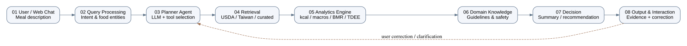
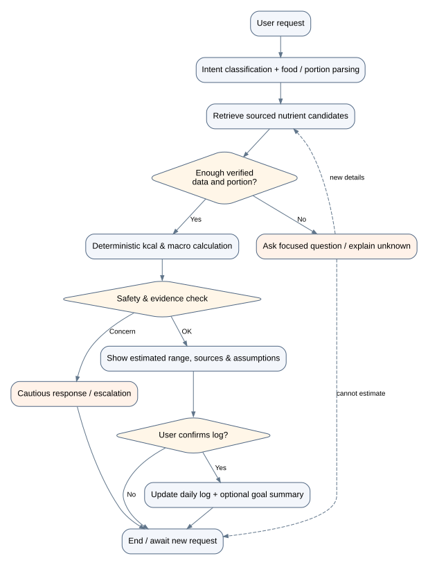

# DietSense — System Design (Living Document)

- Project: **DietSense — A Conversational Domain AI Agent for Daily Calorie Intake Analysis**
- Phase: **Proposal**
- Document version: **0.1.0** (initial GitHub scaffold)
- Last updated: **2026-11-03**
- Source: `docs/proposal/Original_DietSense_Proposal.docx`, sections on agent architecture, flowchart and pseudocode.
- Implementation distinction: descriptions below are **planned** unless explicitly marked **implemented**.

## 1. Project overview and users
Users describe meals conversationally (e.g., "我剛剛吃了一碗加蛋的牛肉麵，湯喝了一半"). DietSense should identify dishes, ingredients and portion uncertainty, retrieve traceable nutrition facts, estimate calorie/macronutrient ranges and update a user-approved daily record. Target: wellness self-monitoring, particularly Taiwanese meals; not diagnosis or clinical dietary prescription.

## 2. System architecture



| ID | Module | Input → Output | Core responsibilities | Status |
|---|---|---|---|---|
| 01 | User / Application Scenario | Natural language → query | Web chat, optional speech | Planned |
| 02 | Query / Input Processing | Query → intent, entities | Normalize language, categorize log/query/analyze/recommend | Planned |
| 03 | Planner & Reasoning Agent | Intent/context → tool plan | LLM tool selection, dialogue memory, clarifying questions | Planned |
| 04 | Data Acquisition / Retrieval | Food descriptors → evidenced candidates | USDA/Taiwan/local records with provenance and units | Planned |
| 05 | Analytics Engine | Nutrient values + grams → kcal/macros/uncertainty | Explicit arithmetic, BMR/TDEE | **Basic kcal and BMR/TDEE implemented** |
| 06 | Domain Knowledge Integration | Calculations → constraints | Public dietary references, portion assumptions, safety rules | Planned |
| 07 | Decision / Recommendation | Evidence + profile → summary | Target comparison, optional safer alternatives | Planned |
| 08 | Output & Interaction | Decisions → UI and log | Explain evidence and assumptions; user confirmation | Planned |

The `src/` directory is a deterministic scaffold. There is **no real multi-step AI agent, RAG index, validated confidence model or user account system yet**.

## 3. Technology stack (proposed, not committed)
- Python 3.10+; standard-library calculator implemented now.
- LLM provider: configurable; avoid hard-coding a particular model release.
- Data adapters: USDA FoodData Central API; Taiwan Food Composition Database subject to data usage terms; curated Taiwanese dish dataset.
- Storage: SQLite for prototyping, then migration if needed.
- Retrieval: normalized keyword / identifier lookup first; add embeddings and RAG only if justified by tests.
- Interface: lightweight web client / chat UI in later phase.
- Version control: GitHub; tests via `unittest`; no paid APIs required to run current scaffold.

## 4. Data flow, agent loop, exceptions



1. Receive request and parse intent and food/portion entities.
2. If user requests nutrient lookup, retrieve multiple candidate records with metadata.
3. Check relevance, provenance, food form (raw/cooked), portion units and consistency.
4. If ingredients or grams are missing and affect estimates materially, ask a concise clarification; limit follow-ups to reduce friction.
5. If no source matches, declare unknown and request recipe details; avoid hallucinated nutrient values.
6. Calculate kcal = grams × kcal_per_100g / 100 and macros similarly; log assumptions.
7. Show provisional estimate **range**, source and assumptions. Do not label an arbitrary heuristic range a 95% confidence interval.
8. Ask for confirmation before committing entries; compute daily summaries and compare to user-provided goals with suitable guardrails.
9. Show output with feedback/error recovery. Avoid unsafe restriction advice and refer concerning situations to qualified care.

**Failure handling:** missing source → transparent unknown; contradictory sources → flagged discrepancy; uncertain portion → follow-up/range; API failure → cached *verified* data if available, otherwise fail gracefully; missing profile fields → no TDEE estimate.

## 5. Data contract (proposed)
```json
{
  "food_name": "example dish",
  "source": "data-provider / dataset-version",
  "source_id": "stable identifier",
  "preparation": "cooked",
  "portion_g": 150.0,
  "kcal_per_100g": 130.0,
  "protein_g_per_100g": 3.0,
  "fat_g_per_100g": 0.3,
  "carbs_g_per_100g": 28.0,
  "assumptions": ["portion estimated from user description"],
  "review_status": "verified or pending"
}
```
All numbers above are **illustrative schema values**, not an authoritative food analysis. The example CSV in `data/` is **fictional**.

## 6. Pseudocode — proposed orchestration
```text
Algorithm 1 DietSense Domain AI Agent
Input: user query Q, consented user profile P, daily log D
Output: evidence-based response R and optionally confirmed updated log D'
1  normalized_query <- normalize(Q)
2  intent, foods, portions <- classify_and_extract(normalized_query)
3  if intent == LOG_FOOD:
4      candidates <- retrieve_sources(foods, USDA, TaiwanDB, curatedDB)
5      matched <- rank_by_identity_preparation_provenance(candidates)
6      if missing_critical_information(matched, portions):
7          ask_clarifying_question(); await user response
8          if still insufficient: return uncertainty_explanation without committing
9      result <- calculator(matched, portions)
10     uncertainty <- derived_from_documented_portion_and_source_variation(result)
11     if user_confirms: D' <- append_log(D, result, source_metadata)
12 else if intent == QUERY_NUTRITION: R <- cited_source_lookup()
13 else if intent == ANALYZE: R <- daily_aggregation(D, P)
14 else if intent == RECOMMEND: R <- bounded_wellness_guidance(D, P)
15 evaluate_safety_and_privacy_constraints()
16 return explain(R, evidence, assumptions, limitations)
```

## 7. Implemented prototype and formulas
`src/dietsense/nutrition.py` implements:
- Energy of a portion: `kcal = grams * kcal_per_100g / 100`.
- Mifflin–St Jeor estimated resting energy (adults):
  - male: `10W + 6.25H - 5A + 5`
  - female: `10W + 6.25H - 5A - 161`
  where W is kg, H is cm and A is years.
- `TDEE = estimated_BMR × activity_factor` (coarse approximation, not measured metabolic rate).
- Input checks for positive parameters and sex specification.

**Not implemented:** multi-food parsing, actual Taiwanese nutrition data import, retrieval/NER, RAG, LLM tool calls, uncertainty calibration, macronutrient summaries, safety flags, diet recommendations, user study.

## 8. Evaluation plan (planned, not achieved)
| Question | Metric | Ground truth / comparison |
|---|---|---|
| Energy estimation | MAE (kcal); % within ±10% / ±20% | Meals with weighed or dietitian-verified values |
| Usability | Entry duration, completion, SUS | Manual app entry vs proposed conversational workflow |
| Robustness | Source match precision, missing-data failure rate | Taiwanese mixed dish prompts with labelled expected behavior |
| Uncertainty | Empirical interval coverage and mean width | Independently labelled portion reference set |
| Safety | Harmful-guidance and hallucination incident rate | Adversarial test scenarios and review rubric |

Original proposal's 500 examples / 20 participants / 7 days and performance targets are **proposals only**, subject to collection, recruitment, time and ethical review. No result is claimed.

## 9. Research gap and design choices
The original proposal focuses on the *integration* of conversational inputs, Taiwanese foods, explicit nutrition calculations, uncertain portions and transparent evidence. Treat novelty and claims about competitor limitations as **hypotheses to validate against properly cited related work**, not assertions that no comparable system exists.

Decision records:
- **D001:** Deterministic arithmetic must be outside the language model.
- **D002:** Every nutrient figure must expose source/provenance or be marked unverified.
- **D003:** Ask clarifying questions when missing details materially affect estimate.
- **D004:** Do not turn heuristic confidence scores into statistical confidence intervals.
- **D005:** No personal/medical information or keys in GitHub.

## 10. Milestones
- [x] Proposal manuscript and PPT (included in `docs/proposal/`)
- [x] GitHub-ready repository scaffold and system design
- [x] Basic energy and BMR/TDEE implementation + unit tests
- [ ] Verified nutrition records and source documentation
- [ ] Parser, source adapters, matching and error recovery
- [ ] Agent planning / bounded LLM tool usage
- [ ] Daily log and optional UI
- [ ] Documented evaluation and results

## 11. Change log
- **2026-11-03 v0.1.0:** Initial proposal-phase design, diagrams and calculator scaffold.

## 12. Source and citation note
The original Word proposal informs the planned system. Some of its reported statistics and article summaries have **not** been checked against primary publications. Verify bibliographic identity, dates and numeric results before using them as scientific evidence. References should be added to a versioned literature table with DOI/URL once confirmed.
